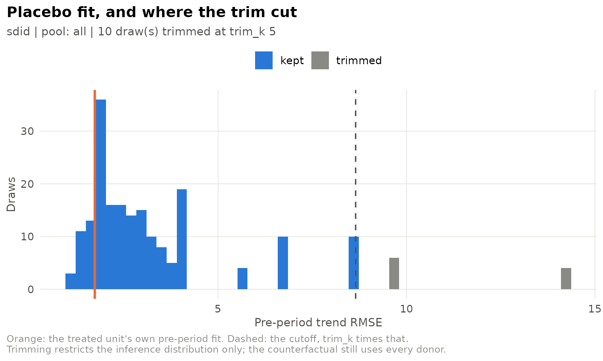
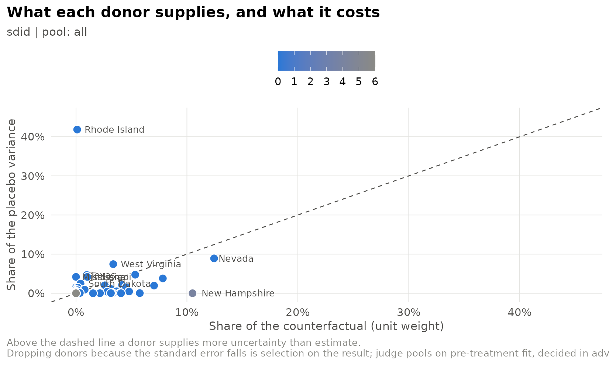

# Placebo inference with one treated unit

``` r

library(sdidlab)
panel <- prop99_panel()
```

## Why placebo inference

Arkhangelsky et al. (2021) offer three variance estimators for SDID:
bootstrap, jackknife and placebo. With a single treated unit, the
bootstrap and the jackknife both need to resample or drop the treated
unit, so they are undefined, and the placebo variance is the one that
applies. It assigns treatment to control units at random, re-estimates
the effect each time, and uses the spread of those placebo effects as
the standard error.

sdidlab computes it exactly as synthdid does. With trimming off
(`trim_k = Inf`), the result is `sqrt(vcov(est, method = "placebo"))`
from synthdid, draw for draw under the same seed:

``` r

setup <- build_setup(sdid_spec(), panel)
est <- synthdid::synthdid_estimate(setup$Y, setup$N0, setup$T0)

set.seed(42); theirs <- sqrt(vcov(est, method = "placebo", replications = 100))
set.seed(42); mine <- placebo_se_trimmed(est, replications = 100, trim_k = Inf)$se
c(synthdid = as.numeric(theirs), sdidlab = mine)
#> synthdid  sdidlab 
#> 10.28802 10.28802
```

## Why trim

The placebo standard error treats every control as a stand-in for the
treated unit. In a large, heterogeneous donor pool, many controls look
nothing like the treated unit: the estimator cannot fit their
pre-period, so their placebo “effects” are large for reasons unrelated
to uncertainty about the treated unit’s effect. Those draws fatten the
tails of the reference distribution and inflate the standard error.

[`placebo_se_trimmed()`](https://james-hodges.github.io/sdidlab/reference/placebo_se_trimmed.md)
drops placebos whose pre-period fit is more than `trim_k` times worse
than the treated unit’s. This is in the spirit of Abadie, Diamond and
Hainmueller (2010), who exclude placebos with poor pre-treatment fit
from their permutation test. Two design points matter:

- **It trims the inference distribution, not the donor pool.** The
  counterfactual is still built from every donor, and the point estimate
  is unchanged.
- **The criterion is pre-treatment fit, decided in advance.** Fit is
  measured without reference to any unit’s estimated effect, so trimming
  cannot be tuned to produce a preferred answer as long as `trim_k` is
  fixed beforehand.

Fit is measured as the RMSE of the treated-minus-synthetic gap after
removing its pre-period mean, because SDID’s unit fixed effects absorb a
constant level difference by design. When covariates are used, it is
computed on the covariate-adjusted outcome the estimator actually fits.

**Trimming is sdidlab’s addition, not part of the SDID paper**, and its
statistical properties are not established in the literature. Report the
untrimmed standard error alongside it, and treat a conclusion that holds
under one but not the other as fragile.

## What trimming did here

[`plot_placebo_trim()`](https://james-hodges.github.io/sdidlab/reference/plots.md)
shows every placebo’s pre-period fit and where the cutoff fell:

``` r

run <- fit_spec(sdid_spec(inference = list(replications = 200)), panel, seed = 1)
plot_placebo_trim(run)
```



``` r

untrimmed <- fit_spec(sdid_spec(inference = list(replications = 200, trim_k = Inf)), panel, seed = 1)
data.frame(
  trim_k = c("Inf (synthdid)", "5"),
  se = c(untrimmed$fit$se, run$fit$se),
  placebos_kept = c(untrimmed$fit$placebos_kept, run$fit$placebos_kept)
)
#>           trim_k        se placebos_kept
#> 1 Inf (synthdid) 10.053244           200
#> 2              5  9.945938           190
```

The 38 Proposition 99 donors are fairly homogeneous, so trimming changes
the standard error only modestly here. It matters most in pools of
hundreds of units with very different trajectories.

## Checking calibration with in-time placebos

A standard error can be checked against a case where the true effect is
known to be zero. Move the treatment date back into the pre-period, fit
only on pre-1989 data, and see how often the resulting \|t\| is large. A
calibrated standard error gives \|t\| \< 1.96 about 95% of the time.
With only a handful of fake dates this is a sanity check, not a test:

``` r

fake_years <- 1980:1986
calib <- do.call(rbind, lapply(fake_years, function(y) {
  do.call(rbind, lapply(c(Inf, 5), function(k) {
    spec <- sdid_spec(design = list(treat_time = y, window = list(end = 1988)),
                      inference = list(replications = 100, trim_k = k))
    r <- fit_spec(spec, panel, seed = seed_for(spec))
    data.frame(fake_year = y, trim_k = k, att = r$fit$att, se = r$fit$se, t = r$fit$t)
  }))
}))
calib$t <- round(calib$t, 2)
calib
#>    fake_year trim_k        att       se     t
#> 1       1980    Inf -2.9249830 7.933177 -0.37
#> 2       1980      5 -2.9249830 5.922795 -0.49
#> 3       1981    Inf -1.5670400 5.882526 -0.27
#> 4       1981      5 -1.5670400 4.974035 -0.32
#> 5       1982    Inf -0.7847873 6.184792 -0.13
#> 6       1982      5 -0.7847873 4.883458 -0.16
#> 7       1983    Inf  0.3179255 7.243450  0.04
#> 8       1983      5  0.3179255 6.576633  0.05
#> 9       1984    Inf  0.5847040 6.802280  0.09
#> 10      1984      5  0.5847040 6.077601  0.10
#> 11      1985    Inf -2.0045623 7.238585 -0.28
#> 12      1985      5 -2.0045623 6.138493 -0.33
#> 13      1986    Inf -1.5173634 4.057389 -0.37
#> 14      1986      5 -1.5173634 3.760828 -0.40
```

With trimming, a large \|t\| on in-time placebos would be a warning that
the trimmed standard error is too small. Running this check on your own
panel is the best guide to whether trimming is appropriate there.

## Which donors drive the standard error

[`donor_influence()`](https://james-hodges.github.io/sdidlab/reference/donor_influence.md)
splits the placebo variance by the control that stood in for the treated
unit in each draw, and sets it against that control’s weight in the
counterfactual:

``` r

plot_donor_influence(run)
```



A donor far above the diagonal adds more uncertainty than it contributes
to the estimate. Dropping donors *because* they raise the standard error
is selection on the result. The figure is for understanding an interval,
not for choosing a pool.
