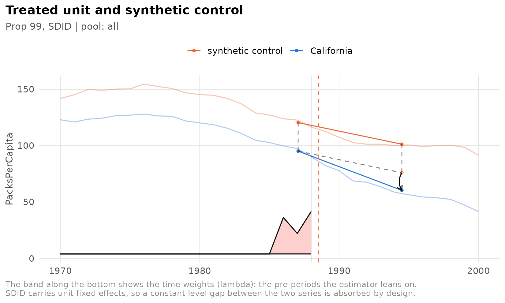
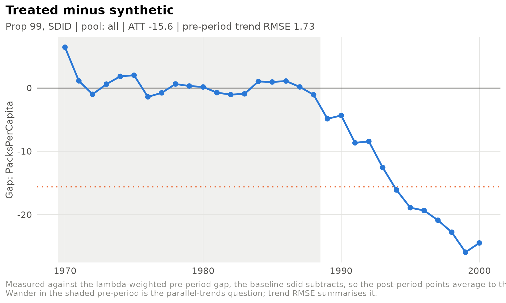
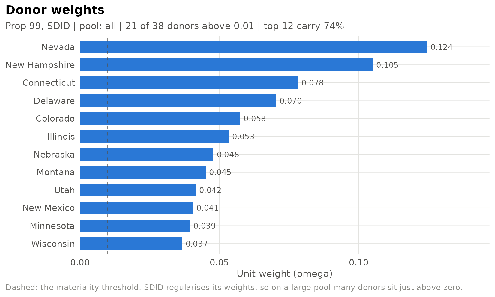
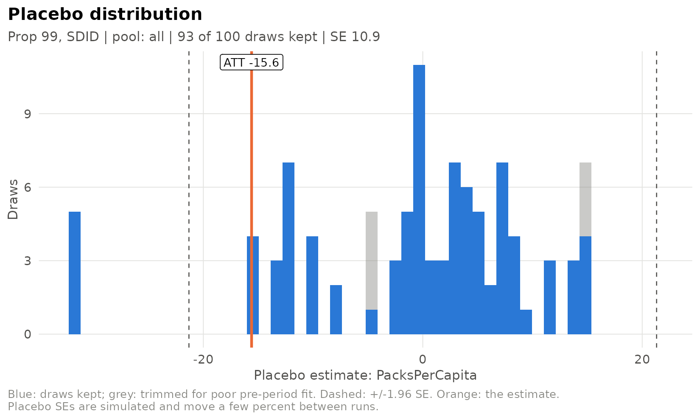
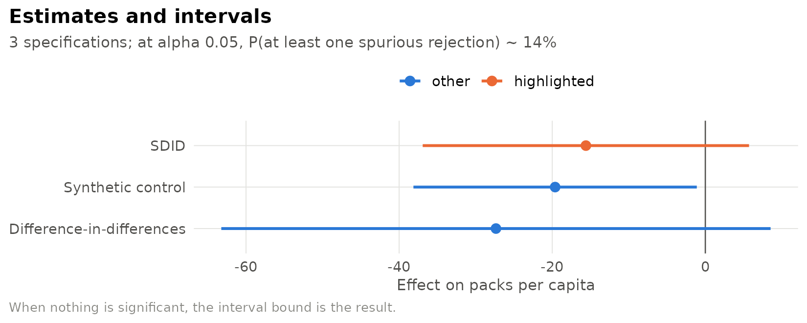

# Getting started

sdidlab fits synthetic difference-in-differences (SDID) for a single
treated unit, with the inference and diagnostics that design needs. This
vignette walks through the whole workflow on the standard example:
California’s Proposition 99, which raised the cigarette tax in 1989.

``` r

library(sdidlab)
```

## A panel

sdidlab works on a long data frame, one row per unit and period. You
declare which columns are which with
[`sdid_panel()`](https://james-hodges.github.io/sdidlab/reference/sdid_panel.md).
The Proposition 99 data ship with synthdid, and
[`prop99_panel()`](https://james-hodges.github.io/sdidlab/reference/prop99_panel.md)
wraps them:

``` r

panel <- prop99_panel()
panel
#> 
#> ── sdid_panel
#> • 39 units (State) x 31 periods (Year, 1970-2000)
#> • outcome PacksPerCapita
#> • treatment treated
#> • columns PacksPerCapita and treated
```

The panel has a 0/1 `treated` column, so sdidlab can work out the
treated unit (California) and the first treated period (1989) by itself.
For your own data, either give
[`sdid_panel()`](https://james-hodges.github.io/sdidlab/reference/sdid_panel.md)
a treatment column or put them in the specification.

## A specification

A specification describes one model completely: outcome, treated unit
and timing, donor pool, covariates, estimator and inference. Anything
you leave out takes its default.

``` r

spec <- sdid_spec(
  label = "Prop 99, SDID",
  inference = list(replications = 100)
)
spec
#> 
#> ── sdid_spec Prop 99, SDID
#> • hash ae352f00fbff
#> • outcome (panel default)
#> • treated from the panel, timing from the panel
#> • window (panel start)-(panel end)
#> • pool all
#> • estimator sdid
#> • inference placebo, 100 reps, trim_k 5
```

## Fitting

[`fit_spec()`](https://james-hodges.github.io/sdidlab/reference/fit_spec.md)
builds the estimator’s inputs, fits the model and runs placebo
inference. Placebo standard errors are simulated, so pass a seed to make
one fit reproducible on its own; `seed_for(spec)` derives one from the
specification itself.

``` r

run <- fit_spec(spec, panel, seed = seed_for(spec))
run
#> 
#> ── sdid_run Prop 99, SDID
#> • ATT -15.6 95% CI [-36.9, 5.71]
#> • SE 10.9 (t = -1.43)
#> • fit sdid, N0 = 38, T0 = 19, pre-period RMSE 1.73
#> • placebos 93/100 kept at trim_k 5
#> • treated California from 1989
#> • spec ae352f00fbff run 20260929T054441400461-ae352f00
```

The estimate is the published one: Arkhangelsky et al. (2021) report
-15.6 packs per capita. The point estimate and weights come straight
from
[`synthdid::synthdid_estimate()`](https://rdrr.io/pkg/synthdid/man/synthdid_estimate.html);
with no trimming (`trim_k = Inf`) the standard error is synthdid’s own
placebo standard error, draw for draw. The default trims placebos that
fit the pre-period more than five times worse than California does – see
[`vignette("placebo-inference")`](https://james-hodges.github.io/sdidlab/articles/placebo-inference.md)
for why.

## Looking at the fit

Every plot takes the run and returns a ggplot. The trajectory shows
California against its synthetic control, with the time weights along
the bottom:

``` r

plot_sdid_trajectory(run)
```



The gap path shows treated minus synthetic in every period, measured
against the baseline SDID subtracts, so its post-period points average
to the ATT:

``` r

plot_gap_path(run)
```



The donor weights show which states make up the synthetic California:

``` r

plot_donor_weights(run, top_n = 12)
```



And the placebo distribution shows where the standard error came from:

``` r

plot_placebo_distribution(run)
```



## Comparing specifications

[`run_specs()`](https://james-hodges.github.io/sdidlab/reference/run_specs.md)
fits a list of specifications, each with its own seed, and
[`sdid_results_table()`](https://james-hodges.github.io/sdidlab/reference/sdid_results_table.md)
collects them. Here the three estimators synthdid provides, plus a
classic synthetic control:

``` r

specs <- list(
  sdid_spec(label = "SDID", inference = list(replications = 100)),
  sdid_spec(label = "Synthetic control", estimator = "sc", inference = list(replications = 100)),
  sdid_spec(label = "Difference-in-differences", estimator = "did", inference = list(replications = 100))
)
runs <- run_specs(specs, panel, progress = FALSE)
results <- sdid_results_table(runs)
results[, c("label", "ATT", "SE", "ci_lo", "ci_hi", "trend_rmse")]
#>                       label    ATT    SE  ci_lo  ci_hi trend_rmse
#> 1                      SDID -15.60 10.90 -36.92  5.710       1.73
#> 2         Synthetic control -19.62  9.44 -38.13 -1.113       1.66
#> 3 Difference-in-differences -27.35 18.30 -63.23  8.527       7.16
```

``` r

plot_att_forest(data.frame(label = results$label, att = results$ATT,
                           ci_lo = results$ci_lo, ci_hi = results$ci_hi),
                highlight = "SDID", xlab = "Effect on packs per capita")
```



## Where next

- [`vignette("specs-and-runs")`](https://james-hodges.github.io/sdidlab/articles/specs-and-runs.md):
  YAML specifications, sweeps, the run store, generating reproducible
  scripts, and plugging in your own outcomes and donor pools.
- [`vignette("placebo-inference")`](https://james-hodges.github.io/sdidlab/articles/placebo-inference.md):
  trimmed placebo inference and its diagnostics.
- [`vignette("synthetic-control")`](https://james-hodges.github.io/sdidlab/articles/synthetic-control.md):
  the bias-corrected synthetic control, exact fits, the Abadie-L’Hour
  penalty and permutation inference.
- [`run_demo()`](https://james-hodges.github.io/sdidlab/reference/run_demo.md)
  opens an interactive app for all of the above.
