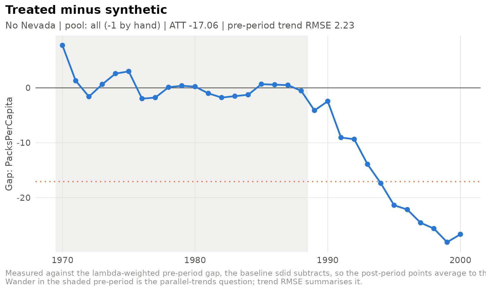

# Specifications, sweeps and the run store

``` r

library(sdidlab)
panel <- prop99_panel()
```

A research design rarely ends at one model. You try other donor pools,
windows, estimators and covariates, and a month later you need to know
exactly which choices produced which number. sdidlab’s answer is to make
every model a **specification**: a declarative record you can hash,
save, refit and regenerate.

## Specifications hash to an identity

``` r

a <- sdid_spec(design = list(window = list(start = 1975)), label = "Late start")
b <- sdid_spec(label = "Same model, new name", design = list(window = list(start = 1975L)))
c(spec_hash(a), spec_hash(b))
#> [1] "cf9bf8b3e4b9" "cf9bf8b3e4b9"
```

The hash ignores labels and notes, the difference between `1975` and
`1975L`, and the order fields were given in. Fields still at their
defaults are dropped before hashing, so adding a new option to sdidlab
never changes an existing specification’s identity.

Specifications are validated when they are built. Mistakes fail loudly:

``` r

sdid_spec(design = list(treat_yr = 1989))
#> Error in `merge_spec()`:
#> ! Unknown field in design: treat_yr.
sdid_spec(design = list(treat_time = 1989, effect_time = 1988))
#> Error in `validate_spec()`:
#> ! design$effect_time (1988) must be strictly later than
#>   design$treat_time (1989).
```

## Design choices

A few of the design fields:

- `design$window`: the periods used, defaulting to the whole panel.
- `design$periods_drop`: periods removed from both the match and the
  effect.
- `design$effect_time`: for outcomes that phase in. Periods from
  `treat_time` up to `effect_time` are dropped, because they are
  contaminated but not yet saturated.
- `pool$drop_units` / `pool$add_units`: hand edits to the donor pool,
  with `pool$exclusion_notes` recording why.

[`build_setup()`](https://james-hodges.github.io/sdidlab/reference/build_setup.md)
shows exactly what a specification selects, including every exclusion
and its reason:

``` r

spec <- sdid_spec(
  design = list(periods_drop = c(1980, 1981)),
  pool = list(drop_units = c("Nevada", "Utah"),
              exclusion_notes = list(Nevada = "large tourist cigarette sales"))
)
setup <- build_setup(spec, panel)
c(N0 = setup$N0, T0 = setup$T0)
#> N0 T0 
#> 36 17
setup$pool[!setup$pool$included, ]
#> # A tibble: 2 × 4
#>   unit   label  included reason                                        
#>   <chr>  <chr>  <lgl>    <chr>                                         
#> 1 Nevada Nevada FALSE    dropped by hand: large tourist cigarette sales
#> 2 Utah   Utah   FALSE    dropped by hand
```

## Sweeps in YAML

Several specifications live in one YAML file. Settings they share are
hoisted into a `defaults:` block, so the file shows exactly what
differs:

``` r

specs <- list(
  sdid_spec(label = "All donors", inference = list(replications = 100)),
  sdid_spec(label = "No Nevada", pool = list(drop_units = "Nevada"),
            inference = list(replications = 100)),
  sdid_spec(label = "From 1975", design = list(window = list(start = 1975)),
            inference = list(replications = 100))
)
cat(write_specs_yaml(specs, NULL, title = "Prop 99 robustness"))
#> # Prop 99 robustness
#> # Placebo standard errors depend on the RNG stream: fit these in file
#> # order under one seed, or with run_specs(seed_each = TRUE).
#> defaults:
#>   inference:
#>     replications: 100
#> specs:
#> - label: All donors
#> - label: No Nevada
#>   pool:
#>     drop_units: Nevada
#> - label: From 1975
#>   design:
#>     window:
#>       start: 1975.0
```

Reading the file back gives the same specifications, with the same
hashes:

``` r

f <- tempfile(fileext = ".yml")
write_specs_yaml(specs, f)
back <- read_specs(f)
identical(vapply(back, spec_hash, ""), vapply(specs, spec_hash, ""))
#> [1] TRUE
```

## The run store

Give
[`fit_spec()`](https://james-hodges.github.io/sdidlab/reference/fit_spec.md)
or
[`run_specs()`](https://james-hodges.github.io/sdidlab/reference/run_specs.md)
a directory and every fit is saved: the specification, the fitted
object, the placebo draws, and the pool and balance records. A saved run
can be reloaded and re-plotted without refitting.

``` r

store <- file.path(tempdir(), "prop99-runs")
runs <- run_specs(specs, panel, store = store, progress = FALSE)
index <- refresh_runs_index(store)
index[, c("label", "spec_hash", "att", "se")]
#> # A tibble: 3 × 4
#>   label      spec_hash      att    se
#>   <chr>      <chr>        <dbl> <dbl>
#> 1 From 1975  d692efccf921 -17.9 10.5 
#> 2 No Nevada  ac577c93aa93 -17.1  9.34
#> 3 All donors ae352f00fbff -15.6 10.9
```

``` r

again <- load_run(index$path[index$label == "No Nevada"])
plot_gap_path(again)
```



[`prune_runs()`](https://james-hodges.github.io/sdidlab/reference/run_store.md)
keeps only the latest few runs of each specification.

## A script that reproduces the results

[`write_spec_script()`](https://james-hodges.github.io/sdidlab/reference/write_spec_script.md)
writes a self-contained R script: your data-loading code, the
specifications (embedded as YAML), and the fit. Every specification is
fitted with its own seed, so the script reproduces each standard error
exactly.

``` r

cat(write_spec_script(specs[1:2], NULL, data_code = "panel <- prop99_panel()",
                      title = "Prop 99 robustness"))
#> # Prop 99 robustness
#> # Generated by sdidlab 0.1.0 on 2026-09-29.
#> # Each specification is fitted with its own seed (seed_for()), so every
#> # standard error reproduces exactly, whatever order the specs are run in.
#> 
#> library(sdidlab)
#> 
#> # -- Data ---------------------------------------------------------------
#> panel <- prop99_panel()
#> 
#> # -- Specifications -----------------------------------------------------
#> spec_yaml <- r"---(
#> # Prop 99 robustness
#> # Placebo standard errors depend on the RNG stream: fit these in file
#> # order under one seed, or with run_specs(seed_each = TRUE).
#> defaults:
#>   inference:
#>     replications: 100
#> specs:
#> - label: All donors
#> - label: No Nevada
#>   pool:
#>     drop_units: Nevada
#> )---"
#> spec_path <- tempfile(fileext = ".yml")
#> writeLines(spec_yaml, spec_path)
#> specs <- read_specs(spec_path)
#> 
#> # -- Fit ------------------------------------------------------------------
#> runs <- run_specs(specs, panel, seed_each = TRUE)
#> results <- sdid_results_table(runs)
#> print(results, row.names = FALSE)
```

## Your own outcomes and donor pools

A specification’s outcome can be any panel column. For outcomes that a
column cannot express, and for named donor pools, register a function:

``` r

register_outcome("log_packs", function(panel, spec) {
  d <- panel$data
  data.frame(unit = d$State, time = d$Year, y = log(d$PacksPerCapita))
}, label = "Log packs per capita")

register_pool("mountain_west", function(panel, spec) {
  c("Colorado", "Idaho", "Montana", "Nevada", "New Mexico", "Utah", "Wyoming")
})

run <- fit_spec(sdid_spec(data = list(outcome = "log_packs"),
                          pool = list(base = "mountain_west"),
                          inference = list(replications = 50)),
                panel, seed = 1)
run
#> 
#> ── sdid_run 546601b348a9
#> • ATT -0.2937 95% CI [-0.415, -0.172]
#> • SE 0.062 (t = -4.74)
#> • fit sdid, N0 = 7, T0 = 19, pre-period RMSE 0.0222
#> • placebos 50/50 kept at trim_k 5
#> • treated California from 1989
#> • spec 546601b348a9 run 20260929T054553921098-546601b3
```

Registered functions receive the whole specification, so a
specification’s free-form `options` section can parameterise them. That
is how a project builds a domain layer (derived outcomes from several
tables, peer groups defined by external rankings) on top of sdidlab
without changing it.
