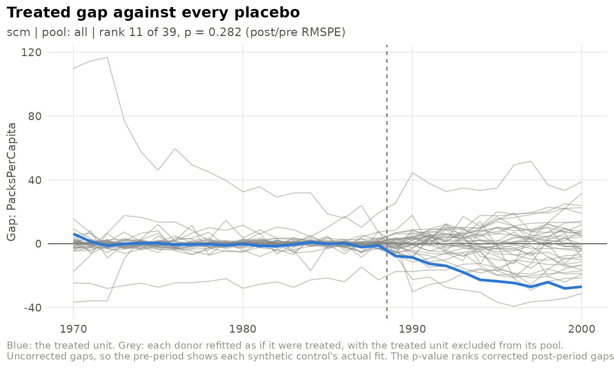

# Synthetic control: bias correction, exact fits and permutation inference

``` r

library(sdidlab)
panel <- prop99_panel()
```

synthdid’s `sc_estimate()` is a synthetic control matched on pre-period
outcomes.
[`fit_scm()`](https://james-hodges.github.io/sdidlab/reference/fit_scm.md)
is the classic Abadie, Diamond and Hainmueller (2010) estimator: it
matches on a predictor matrix with predictor weights `V`, and adds the
Abadie-L’Hour bias correction and penalty. Use it through
[`fit_spec()`](https://james-hodges.github.io/sdidlab/reference/fit_spec.md)
with `estimator = "scm"`, or directly on a matrix.

## The estimator

Donor weights `w` lie on the simplex and minimise the `V`-weighted
discrepancy between the treated unit’s predictors and the weighted
donors’. By default the predictors are the pre-period outcomes,
standardised, with equal weights. `v_method = "mspe"` searches for the
`V` that best fits the pre-period outcome, as `Synth` does.

The weights are solved exactly by an active-set method. The test suite
checks them against the optimality conditions of the problem and against
`Synth`.

``` r

setup <- build_setup(sdid_spec(), panel)
fit <- fit_scm(setup$Y, setup$N0, setup$T0, bias_correct = FALSE)
round(sort(fit$omega[fit$omega > 0], decreasing = TRUE), 3)
#>          Utah       Montana        Nevada   Connecticut New Hampshire 
#>         0.385         0.271         0.186         0.080         0.049 
#>      Colorado 
#>         0.030
fit$att
#> [1] -19.74716
```

## Bias correction

Even a good synthetic control leaves some discrepancy in the predictors,
and that discrepancy biases the estimate. The Abadie-L’Hour correction
regresses the outcome on the predictors among the donors, one period at
a time, and subtracts the model’s prediction of the leftover
discrepancy:

``` r

fit_bc <- suppressMessages(fit_scm(setup$Y, setup$N0, setup$T0))
c(uncorrected = fit$att, corrected = fit_bc$att)
#> uncorrected   corrected 
#>   -19.74716   -12.68546
```

One consequence is easy to misread. **In any period used as a predictor,
the corrected gap is mechanically near zero**, because that period’s
regression fits it almost exactly. Flat pre-period gaps after correction
confirm that the correction ran; they are not evidence of a perfect
match. That is why sdidlab’s SCM figures show the *uncorrected* gap as
the measure of fit.

## Exact fits, and the penalty

When the treated unit’s predictors lie inside the donors’ convex hull,
the synthetic control can match them **exactly**. Many different
weightings then fit equally well, and they imply different
counterfactuals, so the estimate depends on which one the solver happens
to return. It is not identified by the data. sdidlab flags this
(`exact_match`) and warns. When the whole pre-period is reproduced
exactly (`exact_fit`), it also leaves the RMSPE ratio undefined, rather
than letting a near-zero denominator rank the unit first in a
permutation test.

Matching on only three pre-periods makes this easy to see:

``` r

exact <- fit_scm(setup$Y, setup$N0, setup$T0, outcome_periods = c(5, 12, 19),
                 bias_correct = FALSE)
#> Warning: The synthetic control matches the predictors exactly.
#> ℹ The weights are then generally not unique, and different optimal weights
#>   imply different effects.
#> ℹ Treat the estimate as unidentified, or pass a small `penalty` to select the
#>   unique penalised solution (Abadie and L'Hour 2021).
c(exact_match = exact$exact_match, exact_fit = exact$exact_fit)
#> exact_match   exact_fit 
#>        TRUE       FALSE
```

The Abadie and L’Hour (2021) penalty resolves it. Adding
`penalty * sum_j w_j ||X_1 - X_j||^2` to the objective charges for using
donors that are individually far from the treated unit. For any positive
value the weights are unique. A small penalty picks, among the exact
fits, the one built from the nearest donors:

``` r

penalised <- fit_scm(setup$Y, setup$N0, setup$T0, outcome_periods = c(5, 12, 19),
                     bias_correct = FALSE, penalty = 1e-3)
c(unpenalised = exact$att, penalised = penalised$att)
#> unpenalised   penalised 
#>    -23.8400    -23.0008
```

Larger penalties trade pre-period fit for locality. As the penalty
grows, the synthetic control becomes the single nearest donor.

## Permutation inference

The Abadie-style test refits the synthetic control with each donor in
turn standing in as the treated unit, with the real treated unit removed
from its pool, and ranks the treated unit’s ratio of post-period to
pre-period RMSPE against the placebos’. Through
[`fit_spec()`](https://james-hodges.github.io/sdidlab/reference/fit_spec.md)
this happens automatically:

``` r

run <- suppressMessages(suppressWarnings(fit_spec(sdid_spec(estimator = "scm"), panel)))
c(att = run$fit$att, p = run$fit$rmspe_p, rank = run$fit$rmspe_rank, of = run$fit$placebos_total)
#>         att           p        rank          of 
#> -12.6854587   0.2820513  11.0000000  39.0000000
```

``` r

plot_scm_gaps(run)
```



The smallest p-value attainable is one over the number of units: here
0.026. Read it as a rank, not as a continuous p-value.

[`rmspe_pvalue()`](https://james-hodges.github.io/sdidlab/reference/rmspe_pvalue.md)
also supports one-sided tests, which regain some power with few donors
when the direction of the effect is known in advance.
